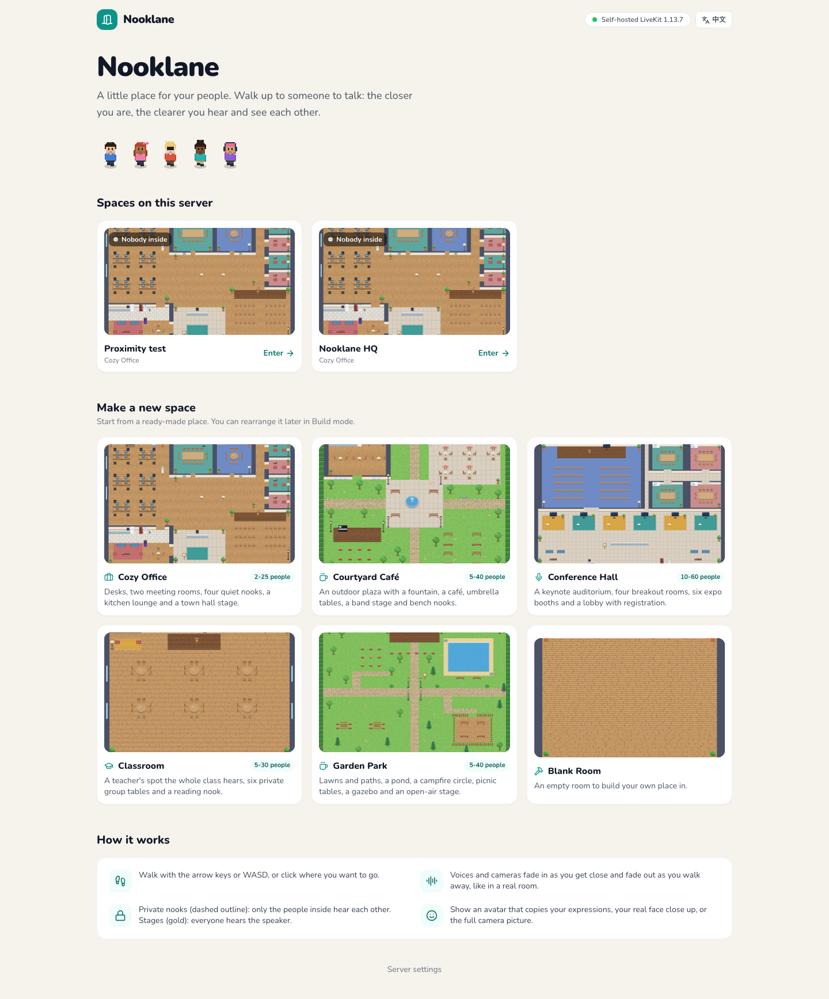
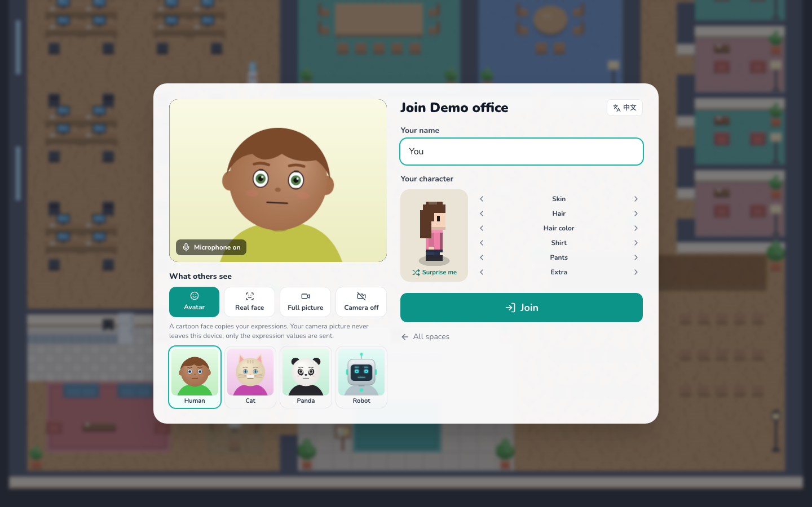
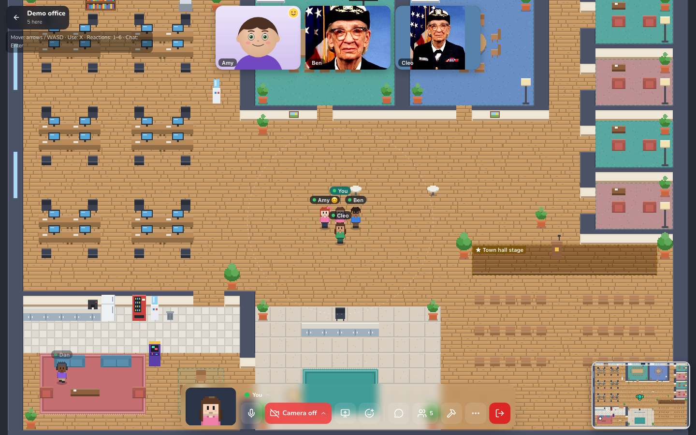
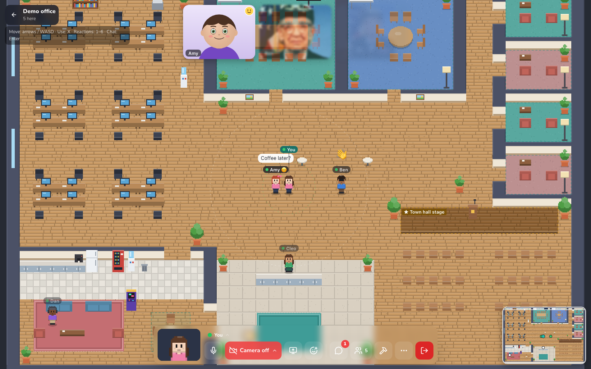
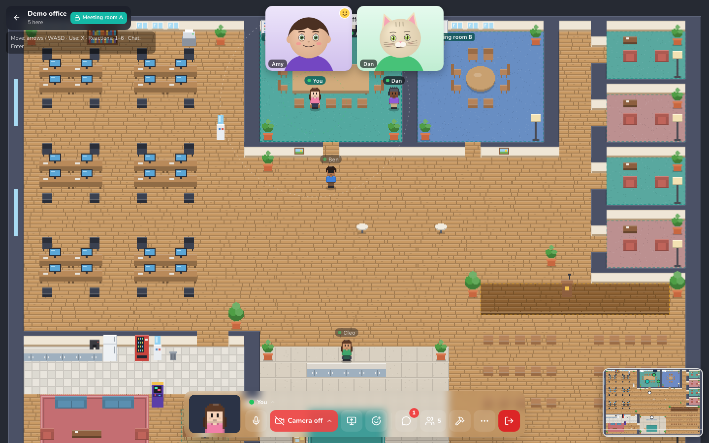
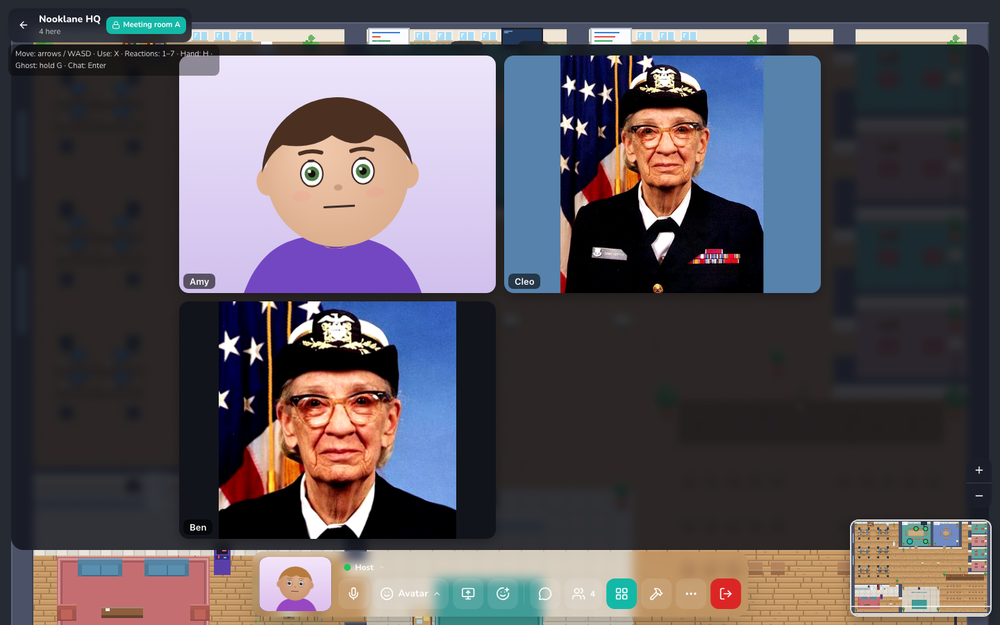
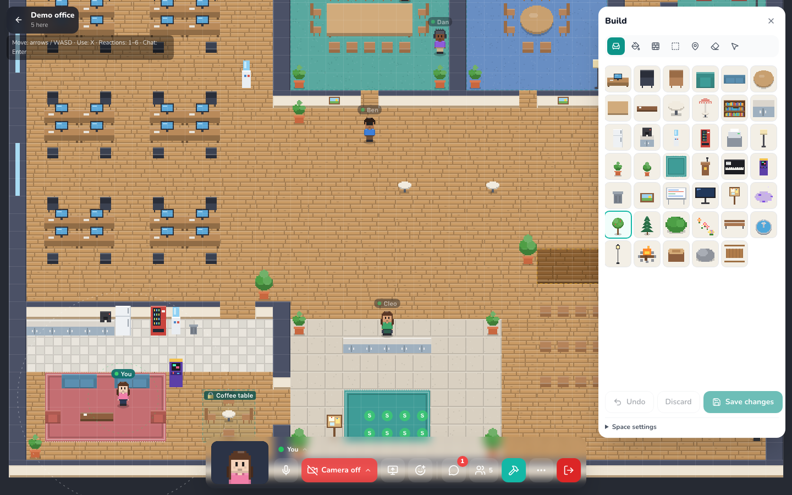

# Nooklane 🏡

A little 2D place for your people, in the spirit of [Gather](https://www.gather.town/), that you host yourself. Everyone walks a pixel-art character around a map; **walk up to someone and you can talk**. Voices and cameras fade in as you get close and fade out as you walk away: the voice gets quieter, muffled and panned to the side it comes from, the picture fades and blurs. Private nooks keep a conversation to the people inside; on a stage, everyone hears the speaker.

Built with [Reflex](https://reflex.dev/) on a **self-hosted, open-source [LiveKit](https://github.com/livekit/livekit) server that runs inside the app's own container**. Install it on [re-ddns](https://github.com/milochen0418/re_ddns) and everyone on your network meets at `https://nooklane.reflex-ddns.com`. No LiveKit Cloud account, no keys, no CDN.

## 📸 Interface Preview

| Spaces and templates | Before joining | Three camera looks |
|:---:|:---:|:---:|
|  |  |  |

| Closer = clearer | A private meeting room | Meeting view |
|:---:|:---:|:---:|
|  |  |  |

| Build mode |
|:---:|
|  |

## 🌟 Features

- **Spaces from templates**: Cozy Office (desks, two meeting rooms, four quiet nooks, kitchen lounge, town hall stage), Courtyard Café, Conference Hall (auditorium, breakout rooms, expo booths), Classroom (teacher's spot, group tables), Garden Park (campfire, gazebo, pond, open-air stage) and a Blank Room. The front page lists every space on the server with live "N inside" badges.
- **Walking**: arrow keys or WASD, or click where you want to go (path finding around furniture). Double-click a person to walk up to them; *Locate*, *Walk to* and *Follow* in the people list; a minimap (click to walk there), zoom buttons and *Back to a start point*.
- **Closer = clearer** (proximity voice and video), worked out in each browser for each person:
  - full voice and a sharp picture within 2 tiles;
  - fading to silence at 6 tiles: volume, a low-pass filter that muffles far voices, left / right panning, the video tile's opacity and blur, and the video layer (high / medium / low);
  - tracks are only received within 7.5 tiles (let go beyond 9), so far-away people cost no bandwidth.
- **Private nooks** (dashed outline): the people inside hear and see each other at full strength, whatever the distance, and nobody outside hears them. **Stages** (gold): whoever stands there is heard and seen by everyone in the space.
- **What others see of you** (switch any time):
  - **Avatar**: a cartoon face (human, cat, panda, robot) copies your expressions. Your face is tracked on your own device with MediaPipe; only the expression values travel (60-byte packets, sent only to the people who can see you), never the camera picture.
  - **Real face**: your real face, close up: the picture follows your face and leaves out the room behind you (a 360 × 360 cut of the camera).
  - **Full picture**: the whole camera picture, like a normal video call.
  - **Camera off**: others see your character.
- **Your character**: skin, hair, hair color, shirt, pants and an extra (glasses, cap, headphones, bow), remembered in your browser.
- **Talking without voice**: chat to the people nearby or to everyone, speech bubbles over heads, reactions on keys 1–7 (👋 ❤️ 🎉 👍 🤣 👏 💯, as in Gather), raise your hand (H), wave at someone (they hear a chime).
- **Meeting view**: everyone you are connected to in a big centered grid over the map (up to 25), at the high video layer; Escape goes back to the map.
- **Ghost mode**: hold G and nobody hears or sees you, and you hear and see nobody (walk past a conversation without joining it).
- **Screen sharing**, shown by the same distance rules; click any tile to enlarge it.
- **Things to use** (X next to them): whiteboards and notice boards anyone can write on, screens that show a link (a page, a video, a document from another app), portals that jump across the map.
- **Build mode** for the space's maker (or with the server's admin passcode): paint floors and walls, place 41 kinds of things, draw private nooks and stages, set start points and portal destinations, undo; Save shows the new layout to everyone in the space at once.
- **Status**: available, do not disturb (nobody hears you and you hear nobody, except in your private nook or from a stage), away (also set after 10 idle minutes).
- English and 繁體中文 (follows the browser, with a switch).

## 🆚 Compared with Gather

Measured in Gather 1.0 ("Classic", an anonymous trial space, October 2026) and read in its help center; Gather 2.0 needs an account, so its side comes from its documentation.

| | Gather 1.0 (measured) | Nooklane |
|---|---|---|
| Full voice and picture | within 2 tiles | within 2 tiles |
| Fading | volume 0.5^(d−2), tile opacity (2/3)^(d−2) | volume (1−t)^1.6, opacity 1−0.82t (t = (d−2)/4), plus blur, left/right panning, a low-pass that muffles far voices, and a lower video layer |
| Cut-off | disconnected from 5 tiles | silent from 6, unsubscribed beyond 9 (subscribed again within 7.5) |
| Private areas | same area: full, whatever the distance; outside: nothing | the same |
| Spotlight | heard by the whole room, private areas too | the same (stages) |
| Do not disturb / Ghost | no A/V while on / while G is held | the same |
| Busy | still connected (yellow dot) | not separate (Do not disturb, Away) |
| Talk in a bubble | outsiders hear ~3 %, see 25 % | not built |
| Camera | the camera picture (background effects in beta) | expression avatar (no picture sent), real-face close-up, full picture, off |
| Media server | Gather's cloud (mediasoup SFU, 3 simulcast layers) | your own LiveKit server, inside the app's container |
| Templates | ~53 in 1.0 (office, social, experience, conference, education, seasonal, blank); 2.0: layout × theme × size | 6 (office, café courtyard, conference, classroom, park, blank) + Build mode |
| Price | from $12–15 per member per month (no free tier since Sep 2025) | free, self-hosted |

Not built (yet): bubbles, desks you claim, doors and knocking, guest check-in, calendar, recording, custom status text, "request to lead", meeting music.

## 📐 How it works

```
Your browser                                         Everyone else's browser
  keys / clicks ─► walk on the map ─► "pos" packet (10 bytes, every step + 1/s) ─┐
  camera ─► MediaPipe (on this device) ─► "face" packet (60 bytes, ≤ 25/s)       │  LiveKit data packets
            └─► face close-up (canvas) or full picture ─► camera track ──────────┤  and tracks, through
  microphone ───────────────────────────────────────────► audio track ───────────┤  the space's room on
  look / camera mode / status / raised hand ─► participant attributes ───────────┘  the embedded server
                                                                                  │
  For each other person, every frame:  distance + areas ─► subscribe or not,
  volume, low-pass, pan, video layer, tile opacity and blur  ◄────────────────────┘
```

Signalling goes through `https://nooklane.reflex-ddns.com/rtc`, which the Reflex backend relays to `livekit-server` on `127.0.0.1:7580`; media goes to the published ports TCP 7581 / UDP 7582 on the host's LAN IP (`EXTERNAL_IP`). Each space is one LiveKit room.

| File | Role |
|------|------|
| `assets/nooklane/client.js` | `window.nooklane`: the room, the packets, moving, the proximity rules, the video tiles. |
| `assets/nooklane/world.js` | The map on a canvas: camera, depth sorting, path finding, name tags, areas. |
| `assets/nooklane/art.js` | All pixel art, drawn in code: 13 floors, 4 walls, 41 things, characters in four directions. |
| `assets/nooklane/media.js` | The four camera modes; one camera stream feeds the tracker, the close-up and the full picture. |
| `assets/nooklane/editor.js` | Build mode. |
| `assets/avatar_face.js`, `face_tracker.js`, `mediapipe/` | Expression avatars and on-device face tracking (shared with the avatar chat app). |
| `nooklane/maps/` | `MapBuilder` and the six templates. |
| `nooklane/spaces.py` | Spaces as JSON files; build keys; what anyone may change. |
| `nooklane/livekit_server.py`, `livekit_proxy.py` | The embedded LiveKit server and the `/rtc`, `/twirp` relays. |
| `nooklane/states/`, `nooklane/pages/` | The Reflex pages around the map. |

**Map format** (`nooklane/maps/builder.py`): `floor` and `walls` rows (one character per tile), `objects` (`{"t": "sofa", "x": 3, "y": 4, "dir": "s"}`), `areas` (`{"name": …, "kind": "private" | "spotlight", "rects": [[x, y, w, h]]}`) and `spawns`.

**Position packet** (topic `pos`, lossy): `0xB1`, flags (1 = teleport), x and y (uint16), direction, sequence number, step time in ms (uint16).

## 🚀 Install on re-ddns (Agentic App Store)

The App Store catalog (`re_ddns/data/appstore_catalog.json`) has an entry for this app:

```json
{
  "id": "nooklane",
  "subdomain": "nooklane",
  "github_repo": "https://github.com/milochen0418/nooklane.git",
  "app_name": "nooklane",
  "volumes": ["smart-app-nooklane-data:/root/.local/share/nooklane"],
  "ports": ["7581:7581", "7582:7582/udp"]
}
```

1. Open `https://aapps.reflex-ddns.com` and install **Nooklane**. The admin passcode is optional.
2. Open `https://nooklane.reflex-ddns.com`, walk into *Nooklane HQ* or make a space from a template, and share its link.

The first start downloads `livekit-server` (about 17 MB) from GitHub releases. Spaces live in the `smart-app-nooklane-data` volume, so they survive a reinstall.

## 💻 Run locally

Prerequisites: Python 3.11, [Poetry](https://python-poetry.org/docs/#installation) and the LiveKit server binary (`brew install livekit` on macOS; Linux downloads it automatically).

```bash
poetry env use python3.11
poetry install
poetry run ./reflex_rerun.sh
```

Open `http://localhost:3000`. Browsers only allow the camera and microphone on secure origins: `localhost` counts as one; from another machine use HTTPS, e.g. through re-ddns.

> If the Docker deployment runs on the same machine, it owns ports 7581/7582. Run the local copy on other media ports:
> `LIVEKIT_RTC_TCP_PORT=7591 LIVEKIT_RTC_UDP_PORT=7592 poetry run ./reflex_rerun.sh`

## ⚙️ Configuration (all optional)

| Variable | Default | Purpose |
|----------|---------|---------|
| `ADMIN_PASSCODE` | *(empty)* | Unlocks `/settings` and Build mode in every space. |
| `NOOKLANE_DATA_DIR` | `~/Library/Application Support/nooklane` (macOS), `~/.local/share/nooklane` (Linux) | Spaces and the LiveKit server's files. |
| `LIVEKIT_NODE_IP` | `EXTERNAL_IP`, else auto | IP address browsers send media to (`rtc.node_ip`); also settable on `/settings`. |
| `LIVEKIT_API_KEY` / `LIVEKIT_API_SECRET` | generated | Fixed credentials (the secret needs 32+ characters). |
| `LIVEKIT_RTC_TCP_PORT` / `LIVEKIT_RTC_UDP_PORT` | `7581` / `7582` | ICE/TCP port and ICE/UDP mux port; must match the published ports. |
| `LIVEKIT_PORT` | `7580` | Signalling/API port (localhost only). |
| `LIVEKIT_SERVER_BIN` / `LIVEKIT_SERVER_VERSION` | PATH, then download / `1.13.7` | The `livekit-server` binary. |
| `LIVEKIT_PUBLIC_URL` | the app's `api_url` | LiveKit URL handed to browsers. |

## 🧪 Tests

Playwright suites live in `testcases/` (see [testcases/README.md](testcases/README.md)); unit tests in `tests/`:

```bash
poetry run ./run_test_suite.sh smoke_home      # front page, templates, server, routes, pre-join
poetry run ./run_test_suite.sh proximity_av    # distance -> voice / picture / subscription, rooms, stage, chat
poetry run ./run_test_suite.sh camera_modes    # avatar / real face / full picture / off as others see them
poetry run ./run_test_suite.sh build_mode      # locked for guests, build + save, boards anyone can write on
poetry run pytest                              # templates, the space store
```

The fake camera of the suites shows a real face (`testcases/fixtures/face.mjpeg`, a public-domain portrait), so MediaPipe tracks it.

## 🩺 Troubleshooting

| Symptom | Fix |
|---------|-----|
| Joined, but nobody hears anyone, or stuck on *Connecting* | Media can't reach the server. On `/settings`, *Media IP* must be the Docker host's LAN IP and the media ports must be published (`docker port smart-app-nooklane`). Allow UDP 7582 / TCP 7581 in the host firewall. |
| *Click to enable audio* | The browser blocked sound until you click; click it (or anywhere). |
| Someone right next to you is silent | One of you is in a private nook (dashed outline) and the other isn't, or one of you is set to *Do not disturb*. |
| *Looking for your face…* stays (avatar mode) | Face the camera in good light, about an arm's length away. |
| No camera prompt from another machine over `http://` | Browsers only give camera and microphone to secure origins. Use `https://nooklane.reflex-ddns.com`. |
| *address already in use* in the server status | Another LiveKit instance holds 7581/7582 (e.g. the Docker deployment and a local run on the same Mac). Use other ports, see above. |

## 📄 License

MIT, see [LICENSE](LICENSE). Bundled third-party files are Apache-2.0: [livekit-client](https://github.com/livekit/client-sdk-js) (`assets/livekit-client.umd.js`, v2.22.3), [MediaPipe Tasks Vision](https://github.com/google-ai-edge/mediapipe) and the Face Landmarker model (`assets/mediapipe/`, see its `NOTICE.md`), and the downloaded [livekit-server](https://github.com/livekit/livekit). The test portrait is in the public domain (see `testcases/fixtures/README.md`). Gather is a trademark of its owner; Nooklane is an independent project and uses none of its art or code.
